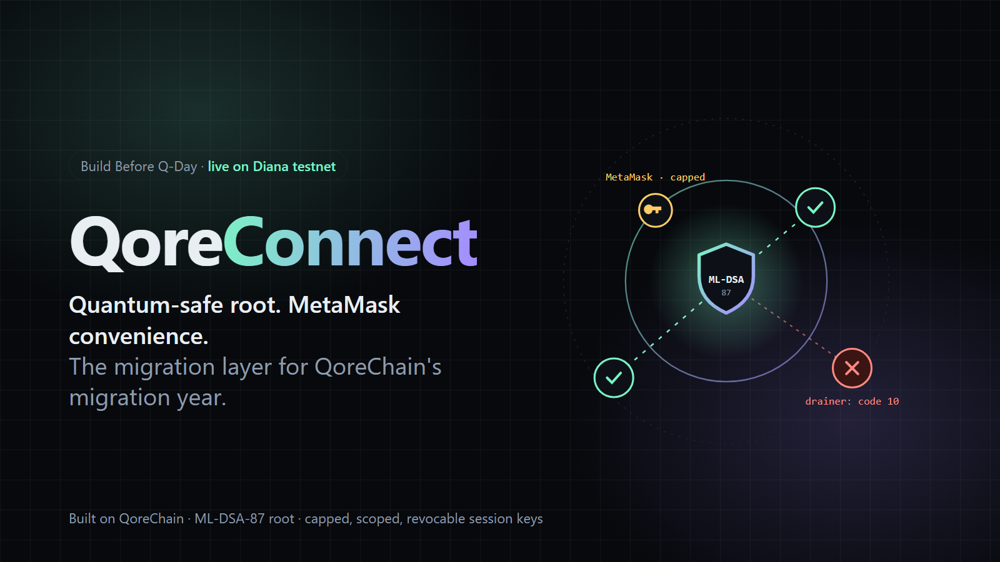
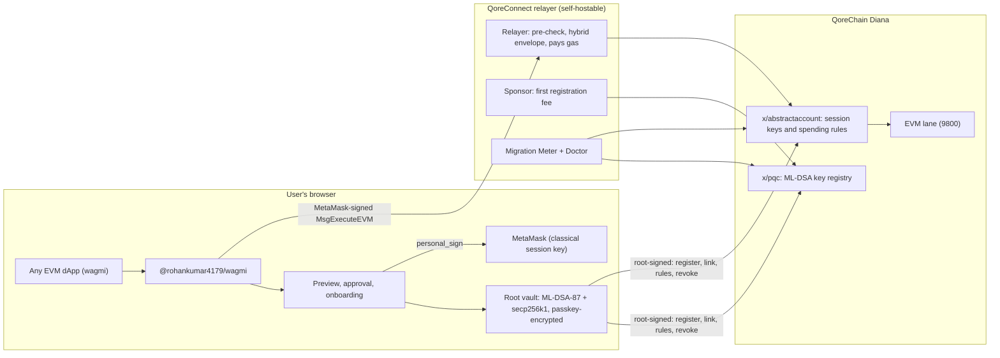

# QoreConnect



> **Quantum-safe root. MetaMask convenience.**
> The migration layer for QoreChain's migration year: any MetaMask user can use any EVM dApp on QoreChain, with a
> post-quantum key in control and the classical key capped, scoped and revocable.

**Live on QoreChain Diana testnet** (EVM chain 9800). Abstract accounts are testnet-only, so QoreConnect does not run on mainnet.
Built for *Build Before Q-Day: The QoreChain Developer Fest*. Not audited; use small amounts.

Demo video: *coming with the submission* ([script](docs/video-script.md)) · Live app: <https://qoreconnect-web.vercel.app> · Demo dApp: <https://qoreconnect-demo.vercel.app> · Relayer: <https://qoreconnect-relayer.onrender.com/health> (free plan: the first request after it has been idle can take about a minute) · [Benchmark](docs/benchmark.md)

---

## The problem

QoreChain only accepts EVM transactions from accounts with a registered post-quantum (ML-DSA-87) key. MetaMask cannot hold
that key, so the Ethereum users QoreChain wants to attract cannot send a single EVM transaction, and every dApp team would
have to rebuild the same onboarding and relayer code. QoreChain's roadmap makes the EVM lane **Required** in Q3 2027, but
only once most EVM traffic already signs hybrid.

## What QoreConnect does

1. **A post-quantum root key in the browser.** One passkey tap creates an ML-DSA-87 + secp256k1 root account. Its seed
   is encrypted on the device; nothing secret leaves the browser.
2. **MetaMask becomes a capped session key.** The root links your MetaMask key with a per-transaction limit, a daily
   limit and an allow-list of the dApps you approved. The chain enforces all three.
3. **A sponsored relayer** submits MetaMask-signed calls and pays gas from dApp-funded gas tanks. New accounts get their
   registration fee sponsored, so a new user needs no QOR at all.
4. **Never sign blind.** Every call is decoded, simulated and checked against your limits *before* MetaMask asks for a
   signature. Calls the chain would refuse are shown as "Blocked by chain".
5. **Q-Day kill switch.** One root-signed transaction revokes every classical key at once.
6. **Agents with the same safety rails.** An AI agent gets its own capped sub-account and acts only on instructions the
   root has signed with ML-DSA-87, so prompt injection cannot spend your money.
7. **Migration Meter and Doctor.** A public page measures how much of QoreChain's EVM activity has a post-quantum root,
   and a Doctor diagnoses any account in one click.
8. **Account services.** A shareable Q-Day exposure report grades any address from live chain state; limit presets
   (Cautious, Everyday, Agent, Gaming) explain in plain English what a key can and cannot do; a countdown warns before
   the MetaMask key expires and renews it with one tap, keeping your limits; an approval scanner lists live token
   allowances and revokes them. On Diana the chain counts token approvals against your limits, so a linked key cannot
   grant an unlimited one ([evidence](docs/security.md#token-approvals-p15-verified-on-diana-22-nov-2026)).

| | Without QoreConnect | With QoreConnect | Source |
|---|---|---|---|
| Signatures for a MetaMask user's first transaction | not possible (no ML-DSA key in MetaMask) | 1 passkey tap + **1** MetaMask signature | [`prompts/STATUS.md`](prompts/STATUS.md) P09 |
| Onboarding time, fresh browser to linked account | not possible | **19.8 s** on the live site (production browser E2E on Diana, 22 Nov 2026; 35 s at P09) | [`prompts/STATUS.md`](prompts/STATUS.md) P15 |
| Loss if the MetaMask key is broken | everything the key controls | at most the daily limit, through approved contracts, until revoked | [`docs/security.md`](docs/security.md) T1 |
| dApp integration | write your own relayer and key setup | one wagmi connector, **9 lines** | [`apps/demo-dapp/src/wagmi.ts`](apps/demo-dapp/src/wagmi.ts) |

## How it works



More: [`architecture/`](architecture/) (account model, flows, relayer, SDK, threat model).

## Quick start

### Run everything locally

Needs Node 22+, pnpm 11 and (for the contracts) Foundry.

```bash
git clone https://github.com/rohan911438/QoreConnect.git && cd QoreConnect
pnpm install
cp .env.example .env          # then fill in SPONSOR_MNEMONIC, RELAYER_MNEMONIC and ADMIN_TOKEN (testnet only!)
pnpm build:packages
pnpm --filter @qoreconnect/relayer-app seed   # create the demo gas tank
pnpm dev:relayer              # http://localhost:8787/health
pnpm dev:web                  # http://localhost:3000 (onboarding, dashboard, /meter, /doctor)
pnpm dev:demo                 # http://localhost:5173 (Quantum Tip Jar demo dApp)
```

The sponsor and relayer accounts need a little testnet QOR on Diana. Use separate accounts and never a mainnet phrase.

### Checks

```bash
pnpm lint && pnpm typecheck && pnpm test     # unit tests (mocked chain), runs in CI
pnpm test:contracts                          # Foundry
pnpm test:integration                        # live on Diana (needs the operator keys)
pnpm demo:attack                             # a drainer dApp tries to empty a QoreConnect account and is refused
```

### Install from npm

| Package | Install | Use it for |
|---|---|---|
| [`@rohankumar4179/wagmi`](https://www.npmjs.com/package/@rohankumar4179/wagmi) | `npm i @rohankumar4179/wagmi` | wagmi connector: add QoreConnect to an existing dApp |
| [`@rohankumar4179/react`](https://www.npmjs.com/package/@rohankumar4179/react) | `npm i @rohankumar4179/react` | Onboarding, signing preview, approval and unlock screens |
| [`@rohankumar4179/core`](https://www.npmjs.com/package/@rohankumar4179/core) | `npm i @rohankumar4179/core` | Root vault, session keys, EIP-1193 provider, agents (wallets, dashboards, non-wagmi apps) |
| [`@rohankumar4179/relayer`](https://www.npmjs.com/package/@rohankumar4179/relayer) | `npm i @rohankumar4179/relayer` | Run your own relayer, sponsor and gas tanks (Node 22.5+) |

For a dApp you need the connector and the UI (wagmi v2):

```bash
npm install @rohankumar4179/wagmi @rohankumar4179/react wagmi@2 viem @tanstack/react-query
```

Each package's npm page explains what it does, how it compares, and how to use it.

### Integrate a dApp (wagmi)

```ts
import { createConfig } from 'wagmi'
import { qoreConnect, qoreTransport, qorechainDiana } from '@rohankumar4179/wagmi'
import { createQoreConnectUI } from '@rohankumar4179/react'

export const ui = createQoreConnectUI()
export const config = createConfig({
  chains: [qorechainDiana],
  connectors: [qoreConnect({ appName: 'My dApp', contracts: ['0xYourContract'], gasTankId: 'my-dapp', relayerUrl: 'https://your-relayer', ui: ui.hooks })],
  transports: { [qorechainDiana.id]: qoreTransport() },
})
// and render <QoreConnectProvider ui={ui}> from @rohankumar4179/react once, near the root of your app.
```

Your existing `useWriteContract` and `useWaitForTransactionReceipt` code works unchanged.

## Repository

| Path | What it is |
|---|---|
| `packages/core` | Root vault, chain client, session keys and rules, EIP-1193 provider, signing preview, agent instructions ([npm](https://www.npmjs.com/package/@rohankumar4179/core)) |
| `packages/wagmi` | wagmi connector and `qoreTransport()` ([npm](https://www.npmjs.com/package/@rohankumar4179/wagmi)) |
| `packages/react` | Onboarding modal, approval sheet, signing preview, unlock prompt ([npm](https://www.npmjs.com/package/@rohankumar4179/react)) |
| `packages/relayer` | Relayer, sponsor, gas tanks, Migration Meter indexer, Doctor ([npm](https://www.npmjs.com/package/@rohankumar4179/relayer)) |
| `apps/relayer` | The relayer server (Hono, Docker) |
| `apps/web` | Next.js app: landing, onboarding, dashboard with kill switch and agents, `/meter`, `/doctor` |
| `apps/demo-dapp` | Quantum Tip Jar (Vite + wagmi) and the attack page |
| `examples/agent` | AI agent that acts only on root-signed instructions (Claude planner with a deterministic fallback) |
| `contracts` | QoreTipJar, Drainer (attack demo), QoreConnectGuard; Foundry tests |

## Testnet evidence

Every claim is backed by a Diana transaction or a script you can rerun: [`docs/testnet-evidence.md`](docs/testnet-evidence.md)
and the per-step log in [`prompts/STATUS.md`](prompts/STATUS.md).

| Contract | Address |
|---|---|
| QoreTipJar | `0x42653b89eff2a993cf2767fedef783366f53aea4` |
| Drainer (attack demo, never approved) | `0x36003c3cea4a8e38cff894cce2c1d1be94e23baa` |
| QoreConnectGuard | `0x1a5b03240e7b3ce11fb8e59ef5da1cb60fbe9eab` |

## Security and honest limitations

The threat model, every mitigation with its code and test, and the invariants are in [`docs/security.md`](docs/security.md).

- The MetaMask key is **classical**: capped, scoped and revocable, not quantum-safe. The root key is the quantum-safe part.
- MetaMask shows a raw digest; QoreConnect's preview is what you read.
- QoreConnect runs on **Diana testnet** only; abstract accounts are switched off on mainnet.
- The relayer is a liveness dependency. It is self-hostable, and the root key can always act directly.
- Passkey PRF is not available in every browser; the fallback is a password.
- Not audited.

## Status

| Feature | Status |
|---|---|
| Root vault (passkey or password), recovery code | Shipped |
| Sponsored onboarding with one MetaMask signature | Shipped |
| Session keys, limits, allow-list, revoke, kill switch | Shipped |
| Relayer with pre-check and gas tanks | Shipped |
| wagmi connector, EIP-1193 provider, signing preview | Shipped |
| Tip Jar demo dApp and attack demo | Shipped |
| Agent mode (root-signed instructions, sub-accounts) | Shipped (live Claude run needs an API key; deterministic planner verified on Diana) |
| Migration Meter and Doctor | Shipped |
| Hosted deployment (web and demo on Vercel, relayer on Render) | Shipped |
| npm packages (`@rohankumar4179/core`, `react`, `wagmi`, `relayer` 0.1.0) | Shipped |
| Demo video | In progress |

## Hackathon

Category: **Post-Quantum AI Agents** (mapping: [`tracks/02-main-track-pq-ai-agents.md`](tracks/02-main-track-pq-ai-agents.md)).
How AI was used to build it: [`AI_USAGE.md`](AI_USAGE.md). Planning documents: [`docs/planning.md`](docs/planning.md).

## Credits

Built on QoreChain's official kits: [`@qorechain/sdk`](https://www.npmjs.com/package/@qorechain/sdk) 0.14.0 (accounts,
hybrid signing, abstract-account messages) and [`@qorechain/pqc`](https://www.npmjs.com/package/@qorechain/pqc) 0.2.3
(ML-DSA-87, used through the SDK's `pqcSign`/`pqcVerify`; pinned in `packages/core` so the version is fixed). Also wagmi, viem, Next.js, Hono, Foundry and the Anthropic SDK.

## Licence

[Apache-2.0](LICENSE)
