<div align="center">

# QoreConnect

### Quantum-safe root. MetaMask convenience.

**The migration layer for QoreChain's migration year.** Any MetaMask user can use any EVM dApp on QoreChain. A post-quantum
ML-DSA-87 key stays in control, and the classical MetaMask key is capped, scoped and revocable, with the limits enforced by the chain.

[](https://build.qorechain.io/p/qoreconnect)
[](LICENSE)
[](https://explore.qore.network)
[](https://www.npmjs.com/package/@rohankumar4179/wagmi)
[](docs/benchmark.md)

[**Live app**](https://qoreconnect-web.vercel.app) ·
[**Demo dApp**](https://qoreconnect-demo.vercel.app) ·
[**Demo video**](https://youtu.be/Uf4OgEPN-0w) ·
[**Submission**](https://build.qorechain.io/p/qoreconnect) ·
[**Developers**](https://qoreconnect-web.vercel.app/developers) ·
[**Testnet evidence**](docs/testnet-evidence.md)


</div>

> [!IMPORTANT]
> QoreConnect runs on the **QoreChain Diana testnet** (EVM chain 9800). QoreChain's abstract accounts are testnet-only,
> so QoreConnect doesn't run on mainnet. It hasn't been audited, so use small amounts. Built for
> *Build Before Q-Day: The QoreChain Developer Fest*: main category **Post-Quantum AI Agents**, plus five special awards ([see tracks](#tracks-and-awards)).

---

## Contents

1. [At a glance](#at-a-glance)
2. [Tracks and awards](#tracks-and-awards)
3. [Why QoreConnect matters](#why-qoreconnect-matters)
4. [Demo video](#demo-video)
5. [The problem](#the-problem)
6. [The solution](#the-solution)
7. [Features](#features)
8. [Architecture](#architecture)
9. [How it works: the flows](#how-it-works-the-flows)
10. [Security model](#security-model)
11. [Measured results](#measured-results)
12. [Engineering and optimizations](#engineering-and-optimizations)
13. [How it compares](#how-it-compares)
14. [Quick start](#quick-start)
15. [Integrate a dApp](#integrate-a-dapp)
16. [npm packages](#npm-packages)
17. [Relayer API](#relayer-api)
18. [Repository layout](#repository-layout)
19. [Testing and quality](#testing-and-quality)
20. [Testnet evidence and contracts](#testnet-evidence-and-contracts)
21. [Honest limitations](#honest-limitations)
22. [Status and roadmap](#status-and-roadmap)
23. [All links](#all-links)
24. [Credits and licence](#credits-and-licence)

---

## At a glance

| | |
|---|---|
| **For users** | Keep MetaMask. One passkey tap and **one** MetaMask signature give you a QoreChain account whose root key is post-quantum. You need **no QOR** to start. |
| **For dApps** | Add one wagmi connector (**9 lines**). Your `useWriteContract` code keeps working, and users arrive from MetaMask without buying gas. |
| **For agents** | An AI agent gets its own capped sub-account and acts **only** on instructions the root has signed with ML-DSA-87. Prompt injection can't spend your money. |
| **For QoreChain** | Moves EVM traffic onto post-quantum roots, which is the condition on QoreChain's roadmap for making the hybrid EVM lane **Required** in Q3 2027. |
| **Tracks** | 🏆 Post-Quantum AI Agents (main) · 🤖 Best AI-Native Build · 🗳️ People's Choice · 🎓 Quantum Campus · 🌍 Regional · ⭐ Top-Quality: [details](#tracks-and-awards) |
| **Proof** | Every claim links to a Diana transaction or a script you can rerun: [`docs/testnet-evidence.md`](docs/testnet-evidence.md). |

---

## Tracks and awards

QoreConnect is entered in **one main category**, as the rules allow, and in **five special awards**. The submission page is
<https://build.qorechain.io/p/qoreconnect>.

| # | Track / award | Type | Prize | Why QoreConnect qualifies | Evidence |
|---|---|---|---|---|---|
| 1 | 🏆 **Post-Quantum AI Agents** | Main category | $1,500 / $750 | Agents *are* abstract accounts with linked, limited keys, which is exactly what QoreConnect builds, for humans and AI alike | [Requirement mapping ↓](#1-main-category-post-quantum-ai-agents) |
| 2 | 🤖 **Best AI-Native Build** | Special award | $500 | Built AI-native with 16 gated prompts; AI also runs *inside* the product behind hard safety rails | [`AI_USAGE.md`](AI_USAGE.md) |
| 3 | 🗳️ **People's Choice** | Community vote | $500 / $300 / $200 | Useful to every MetaMask user and every QoreChain dApp team, with a public, shareable Migration Meter | [Live app](https://qoreconnect-web.vercel.app) |
| 4 | 🎓 **Quantum Campus** | Special award | $500 | Built by a team of enrolled students | Verified by student email on build.qorechain.io |
| 5 | 🌍 **Regional Awards** | Special award | 5 × $200 | Region chosen on the project form | Project form |
| 6 | ⭐ **Top-Quality Awards** | Special award | 7 × $250 | Jury score of at least 70/100: tested, documented, deployed and backed by testnet evidence | [Testing](#testing-and-quality) · [Evidence](#testnet-evidence-and-contracts) |

> Regional and Top-Quality Awards go only to projects that win no other prize, so they act as a safety net under the
> category and special-award targets.

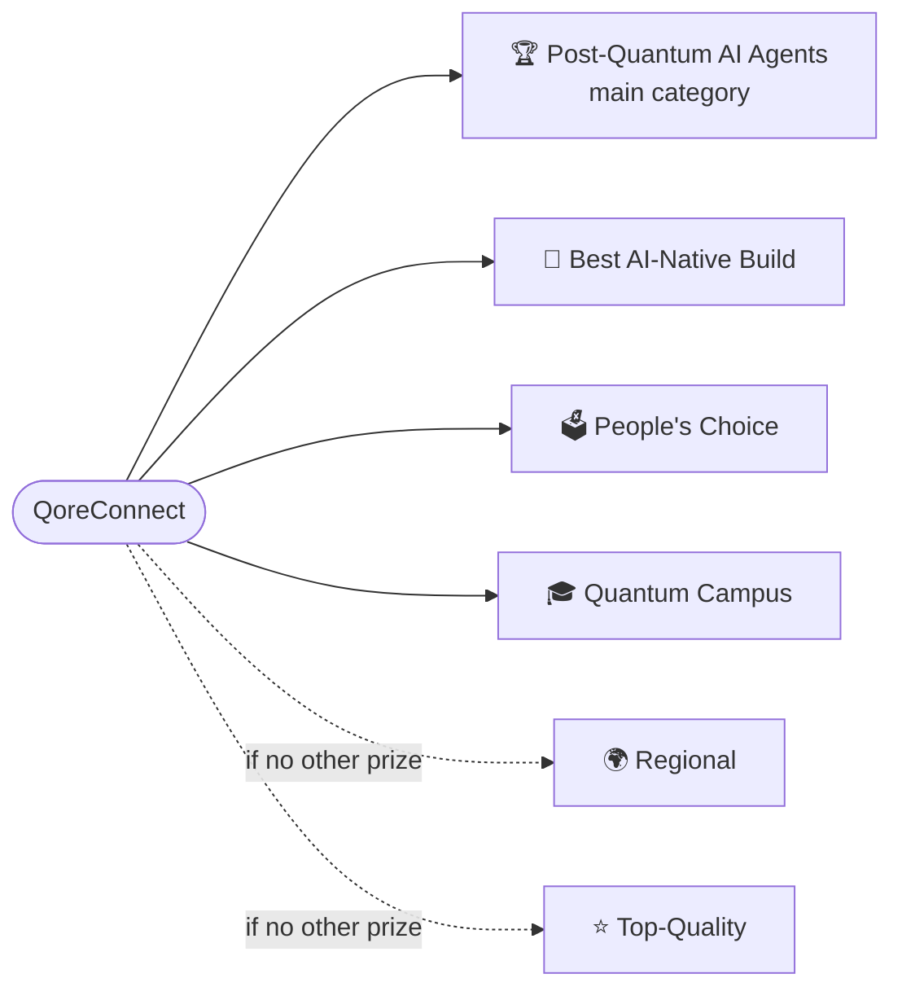

### 1. Main category: Post-Quantum AI Agents

**Why this category:** in QoreChain's own terminology, an agent is an abstract account with linked, limited keys. In
QoreConnect, a MetaMask session key and an AI agent key are the **same mechanism**: a key the post-quantum root links with
caps, a contract allow-list and an expiry. One permission layer serves both humans and AI agents.

| # | Category requirement | How QoreConnect meets it | Proven on Diana |
|---|---|---|---|
| R1 | **Scoped EVM window** | The root opens EVM windows with tight bounds (blocks, transactions, total uqor); the demo contracts were deployed inside one | [`0x24f70a3e…d556`](https://explore.qore.network/tx/0x24f70a3e3bafce83258cdc8591881f1d10864fcd05b547cddeb125d7d272d556) |
| R2 | **Transaction limits** | `perTxLimit` on every session and agent key (defaults: 1 QOR for MetaMask, 0.5 QOR for agents) | Per-tx refusals in the relay integration tests |
| R3 | **Value limits** | `dailyLimit` for every denom; token approvals count against it too | Daily cap refused, code 5: [`4308ADCC…CEB8`](https://explore.qore.network/tx/4308ADCC09358FB59E53F9899938317D68E91ED1ADF5341F296732515638CEB8) |
| R4 | **Duration limits** | Expiry on every key (7 days MetaMask, 24 h agents), a countdown, and one-tap renewal | Doctor run with a 75-second link, before and after expiry (P12) |
| R5 | **Target limits** | `allowed_evm_calls`, as `0xTARGET` or `0xTARGET/0xSELECTOR`, set to the approved dApp's contracts | Drainer refused, code 10: [`125E638C…EFF6`](https://explore.qore.network/tx/125E638C8670B49394EDF8F10BCE9DAC7C993A508D57833F9EAFC8B179B5EFF6) |
| R6 | **Smart-account spending rules** | Link + rules + allow-list in one root-signed tx; read-merge-write keeps every other rule | Link: [`08EAAB70…3C07`](https://explore.qore.network/tx/08EAAB70FF9AD7B5AE9875A8F58522A1A98EFF97CDF66794FED1474932ED3C07) |
| R7 | **Authenticated messaging** | (a) Every session-key action is an EIP-191 authorisation with a per-key nonce; (b) owner → agent instructions are signed with ML-DSA-87 by the root and verified against the key registered on chain | Agent action: [`B10FCF49…75D5`](https://explore.qore.network/tx/B10FCF490C23D5578EFE81CFDEB1519A88BFA68B7650345E81B53405C36275D5) |
| R8 | **AI agent** | An AI agent (Claude planner via the Anthropic SDK, deterministic fallback) on its own capped sub-account | Prompt injection refused, code 10: [`AABFD632…DB6C`](https://explore.qore.network/tx/AABFD6321D45E1652B320FFB2222163C2824E711BCADE484C168F8171D36DB6C) |

**What sets it apart in this category:**

| | Typical agent entry | QoreConnect |
|---|---|---|
| Who it serves | One agent, one owner | Every MetaMask user, every dApp, *and* agents |
| Reusability | A demo script | Four npm packages, a 9-line integration, a self-hostable relayer |
| Onboarding | Assumes QoreX and test QOR | Sponsored onboarding from MetaMask only, 0 QOR |
| Prompt-injection defence | Prompt rules | ML-DSA-87-signed instructions + local guard + **chain-enforced** caps |
| Ecosystem impact | Ends with the demo | Moves EVM traffic onto post-quantum roots, measured by the public Migration Meter |

**Kits and network features used:**

| Kits | Network features |
|---|---|
| [`@qorechain/sdk`](https://www.npmjs.com/package/@qorechain/sdk) 0.14.0 (TypeScript) · [`@qorechain/pqc`](https://www.npmjs.com/package/@qorechain/pqc) 0.2.3 (TypeScript) | Hybrid ML-DSA-87 transactions · PQC key registration with proof of possession · scoped EVM window · Solidity PQC signature check (`pqcVerify`) · Solidity PQC key status (`pqcKeyStatus`) · smart accounts and spending rules |

The full mapping, risks and fallback are in [`tracks/02-main-track-pq-ai-agents.md`](tracks/02-main-track-pq-ai-agents.md).

### 2. Best AI-Native Build

| Requirement | QoreConnect |
|---|---|
| `AI_USAGE.md` in the repo | ✅ [`AI_USAGE.md`](AI_USAGE.md): tools, workflow, a per-component table, mistakes AI made and how they were caught |
| AI-native tick on the form | ✅ |

- **Built AI-native.** 16 written prompts ([`prompts/`](prompts/)), each with deliverables, a validation gate and a failure
  branch. A gate had to pass on the live Diana testnet before the next prompt started, and every result and deviation is logged
  in [`prompts/STATUS.md`](prompts/STATUS.md). Checks that need a human are marked *manual pending* rather than claimed.
- **AI inside the product.** Agent mode puts an AI agent on-chain safely: owner-signed ML-DSA-87 instructions, a local
  target/selector guard, strict tool schemas and cost caps, and chain-enforced spending limits underneath.

### 3. People's Choice

A QoreX community vote on mainnet, **6–15 Dec 2026** (3 votes per wallet holding at least 10 QOR, one per project).

- **Useful to every voter:** anyone with MetaMask can try it in 60 seconds on the [demo dApp](https://qoreconnect-demo.vercel.app).
- **Useful to every builder:** each team building an EVM dApp on QoreChain can integrate it in 9 lines.
- **Shareable:** the public [Migration Meter](https://qoreconnect-web.vercel.app/meter) and per-address
  [Q-Day exposure reports](https://qoreconnect-web.vercel.app/exposure) are made to be shared.

**Vote for QoreConnect:** <https://build.qorechain.io/p/qoreconnect> · #BuildBeforeQDay

### 4. Quantum Campus

Every team member is a currently enrolled student, verified by student email on build.qorechain.io. **QoreConnect is built by students.**

### 5. Regional Awards and 6. Top-Quality Awards

These fallback awards go only to projects that win no other prize. Top-Quality needs a jury score of at least **70/100**,
which is what the rest of this README is built to earn:

| Jury lens | Where to look |
|---|---|
| Does it work? | [Live app](https://qoreconnect-web.vercel.app), [demo dApp](https://qoreconnect-demo.vercel.app), [video](https://youtu.be/Uf4OgEPN-0w) |
| Is it real? | 9 required transaction types with Diana hashes: [`docs/testnet-evidence.md`](docs/testnet-evidence.md) |
| Is it safe? | 19 threats mapped to code and tests, 5 invariants verified live: [`docs/security.md`](docs/security.md) |
| Is it well built? | 130+ unit tests, 35 Foundry tests, production E2E, CI with secret scanning: [Testing](#testing-and-quality) |
| Is it honest? | [Honest limitations](#honest-limitations), with classical signatures labelled classical |
| Is it reusable? | [npm packages](#npm-packages) and a [self-hostable relayer](#self-host-the-relayer-docker) |

### Event details

| | |
|---|---|
| Event | [Build Before Q-Day: The QoreChain Developer Fest](https://build.qorechain.io) |
| Network | QoreChain Diana testnet (`qorechain-diana`, EVM chain 9800) |
| Submission deadline | 2 Dec 2026, 23:59 UTC |
| Judging and People's Choice | 6–15 Dec 2026 |
| Planning documents | [`tracks/`](tracks/), [`docs/planning.md`](docs/planning.md), [`idea/`](idea/), [`prompts/`](prompts/) |

---

## Why QoreConnect matters

Most post-quantum projects ask users to **leave** the tools they already use. QoreConnect does the opposite: it meets
MetaMask users where they are and quietly moves the authority underneath them to a post-quantum key.

| Lens | What QoreConnect delivers |
|---|---|
| **Ecosystem impact** | It goes straight at QoreChain's own 2027 condition, that most EVM traffic must sign hybrid before the EVM lane becomes Required. Every QoreConnect user is EVM traffic with a post-quantum root, and the public [Migration Meter](https://qoreconnect-web.vercel.app/meter) measures that progress. |
| **Real usability** | 1 passkey tap, 1 MetaMask signature, 0 QOR, **19.8 s**. No new wallet, no seed phrase to write down first, no faucet. |
| **Security you can verify** | Limits are enforced by QoreChain's consensus, not by our UI or a custom contract. A stolen key sent through an attacker's own relayer was still refused, and the transaction is public. |
| **Reusable infrastructure** | It isn't a demo: four npm packages, a 9-line wagmi integration, and a self-hostable Docker relayer. Every QoreChain dApp can adopt it without rebuilding PQC onboarding. |
| **Agents done safely** | Humans and AI agents share **one** permission layer. Agents act only on ML-DSA-87-signed owner instructions, inside their own capped sub-account. |
| **Proof over promises** | 9 required transaction types, each with a Diana hash; 19 threats mapped to code lines and tests; 5 invariants verified live. |

### Design principles

| Principle | How it shows up |
|---|---|
| **Never sign blind** | Every call is decoded, simulated and checked against your on-chain limits before MetaMask opens, and the signed digest is bound to that exact preview. |
| **Honesty built in** | Classical signatures are labelled classical. The README states what isn't quantum-safe, what isn't audited, and that it's testnet-only. |
| **A number that can be checked is a fact** | Every metric in this README links to a transaction, a test or a script you can rerun. |
| **No flag-days** | Users keep MetaMask today and move up to a fully post-quantum wallet whenever they're ready. Nothing breaks on the way. |
| **Least authority by default** | New keys start capped (1 QOR per tx, 5 QOR per day, 7 days) and scoped to the approved dApp's contracts. Agent keys are tighter still. |

---

## Demo video

[](https://youtu.be/Uf4OgEPN-0w)

**▶ <https://youtu.be/Uf4OgEPN-0w>**: onboarding from MetaMask, a sponsored first transaction, the signing preview, a drainer
attack refused by the chain, an AI agent on root-signed instructions, and the Q-Day kill switch. Script:
[`docs/video-script.md`](docs/video-script.md).

---

## The problem

QoreChain is preparing for **Q-Day**, the day a quantum computer can forge the elliptic-curve (secp256k1) signatures that
MetaMask and every Ethereum wallet rely on. To get ready, **QoreChain only accepts EVM transactions from accounts that have a
registered post-quantum (ML-DSA-87) key.**

That creates a migration deadlock:

| Who | Pain |
|---|---|
| **Ethereum users** | MetaMask can't hold an ML-DSA-87 key, so a MetaMask user can't send a **single** EVM transaction on QoreChain. Their only option is to switch wallets, generate new keys and buy QOR first. |
| **dApp teams** | Every team porting a Solidity dApp must rebuild the same thing: PQC onboarding, key registration, a relayer, gas sponsorship and limit handling. Most won't, and users drop off at "install a new wallet". |
| **QoreChain** | Its roadmap makes the hybrid EVM lane **Required** in Q3 2027, but only after a supermajority of EVM traffic already signs hybrid. Without a bridge from the wallets people already use, that traffic doesn't appear. |
| **Everyone, at Q-Day** | A plain secp256k1 key controls *everything* it owns. When it breaks, the loss is total and immediate. |

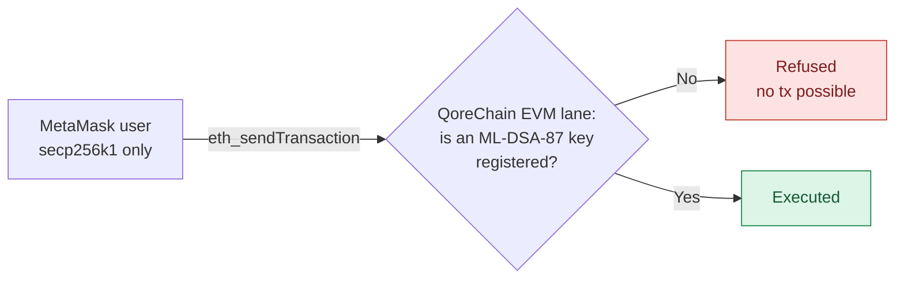

---

## The solution

QoreConnect splits **authority** from **convenience**:

- **Authority** lives in a **post-quantum root**: an ML-DSA-87 + secp256k1 hybrid account created in your browser, its seed
  encrypted on your device with a passkey. Only the root can add or remove keys, change limits, or revoke everything.
- **Convenience** stays with **MetaMask**, linked as a *session key* through QoreChain's abstract-account module. It carries a
  per-transaction limit, a daily limit, an allow-list of the dApp contracts you approved, and an expiry. **The chain**
  enforces all of these, not a UI and not a contract we wrote.
- A **sponsored relayer** carries MetaMask-signed calls to the chain inside a hybrid-signed envelope and pays the gas from
  dApp-funded gas tanks. A sponsor pays a new user's key-registration fee, so the user needs **zero QOR**.

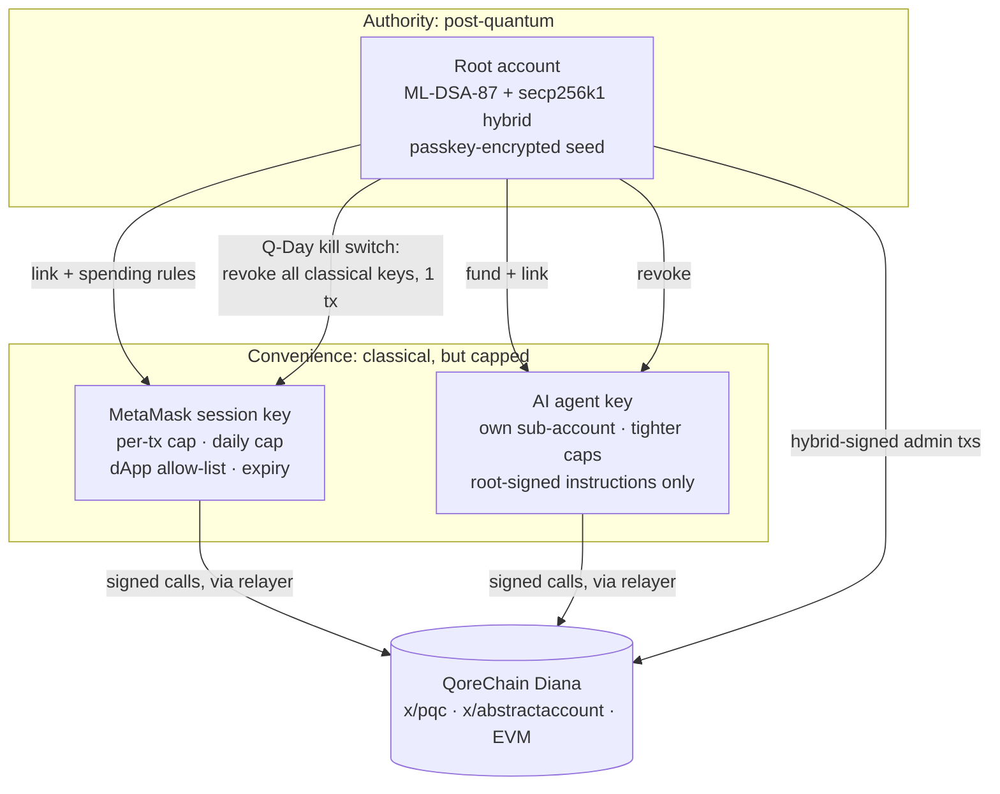

**If the MetaMask key is ever broken**, by a quantum computer, malware or a phishing site, the attacker gets *at most the daily
limit, only through contracts you approved, only until the key expires or you press the kill switch*. The key that can undo
everything is post-quantum.

---

## Features

| # | Feature | What it does | Where |
|---|---|---|---|
| 1 | **Post-quantum root in the browser** | One passkey tap creates an ML-DSA-87 + secp256k1 root. The seed is AES-GCM encrypted with a passkey-PRF key (password fallback) and never leaves the device. A recovery code moves it to a new device. | [`packages/core/src/vault`](packages/core/src/vault) |
| 2 | **MetaMask as a capped session key** | The root links MetaMask with per-tx and daily limits, an allow-list (`0xTARGET` or `0xTARGET/0xSELECTOR`) and an expiry, all in one root-signed transaction. | [`packages/core/src/account`](packages/core/src/account) |
| 3 | **Zero-QOR sponsored onboarding** | A sponsor pays the ML-DSA key registration and first link. dApp gas tanks pay for every call afterwards. | [`packages/relayer/src/sponsor.ts`](packages/relayer/src/sponsor.ts) |
| 4 | **Never sign blind** | Every call is decoded, simulated (`eth_call`) and checked against your on-chain limits before MetaMask is asked. Calls the chain would refuse show as **"Blocked by chain"** with no signing button. | [`packages/core/src/preview`](packages/core/src/preview) |
| 5 | **Q-Day kill switch** | One root-signed transaction revokes **every** classical key at once. | [Dashboard](https://qoreconnect-web.vercel.app/account) |
| 6 | **AI agents with safety rails** | An agent (Claude via the Anthropic SDK, with a deterministic fallback planner) gets its own sub-account and capped key. It acts only on ML-DSA-87 instructions signed by its owner's root, checked against the key registered on chain. | [`examples/agent`](examples/agent), [`packages/core/src/agent.ts`](packages/core/src/agent.ts) |
| 7 | **Migration Meter** | A public page that measures how much of QoreChain's EVM activity has a post-quantum root, with source links. | [/meter](https://qoreconnect-web.vercel.app/meter), [`docs/migration-meter.md`](docs/migration-meter.md) |
| 8 | **Doctor** | Diagnoses any account in one click (PQC key, authenticator, rules, allow-list, expiry, gas tank) and offers the fix. | [/doctor](https://qoreconnect-web.vercel.app/doctor) |
| 9 | **Q-Day exposure report** | A shareable grade for any address, computed from live chain state. | [/exposure](https://qoreconnect-web.vercel.app/exposure), [`docs/exposure.md`](docs/exposure.md) |
| 10 | **Limit presets** | Cautious, Everyday, Agent and Gaming presets explain in plain English what a key can and can't do. | [Dashboard](https://qoreconnect-web.vercel.app/account) |
| 11 | **Expiry countdown and one-tap renewal** | Warns before the MetaMask key expires and renews it with your limits kept. | [Dashboard](https://qoreconnect-web.vercel.app/account) |
| 12 | **Approval scanner** | Lists live ERC-20 allowances and revokes them. On Diana the chain counts approvals against your limits, so a linked key can't grant an unlimited one ([evidence](docs/security.md#token-approvals-p15-verified-on-diana-22-nov-2026)). | [Dashboard](https://qoreconnect-web.vercel.app/account) |
| 13 | **On-chain PQC guard** | `QoreConnectGuard` requires an ML-DSA-87 signature from the root, checked with the `pqcVerify` precompile and `pqcKeyStatus` (possessionProven), for high-value actions. | [`contracts/src/QoreConnectGuard.sol`](contracts/src/QoreConnectGuard.sol) |
| 14 | **Drop-in SDK** | A wagmi v2 connector, an EIP-1193 provider (it announces itself via EIP-6963) and React UI, published on npm. The relayer is self-hostable. | [npm packages](#npm-packages) |

---

## Architecture

### System overview

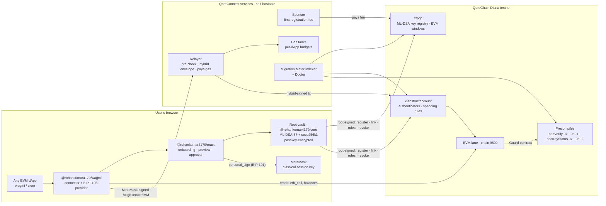

### Component responsibilities

| Component | Package / app | Responsibility |
|---|---|---|
| Root key vault | `packages/core` | Generates the seed, derives the QoreChain account and ML-DSA-87 key with the official SDK, encrypts with a passkey-derived key, exports the recovery code, signs root transactions |
| Chain client | `packages/core` | ML-DSA key registration with possession proof, authenticator link, spending-rule updates (read-merge-write), EVM windows, revoke; reads nonces, rules, authenticators and key status |
| EIP-1193 provider | `packages/core` | Intercepts `eth_sendTransaction`, previews it, has MetaMask sign the digest, sends it to the relayer, and verifies the result on chain. Reads go to the public EVM RPC |
| wagmi connector | `packages/wagmi` | Wraps the provider as a wagmi connector plus `qoreTransport()` and the `qorechainDiana` chain |
| React UI kit | `packages/react` | Onboarding modal, approve-dApp sheet, signing preview, unlock prompt, honesty labels |
| Relayer | `packages/relayer` + `apps/relayer` | Validates, pre-checks, wraps the call in a hybrid envelope, broadcasts, verifies `success=true`, charges the gas tank |
| Sponsor | `packages/relayer` | Funds a new account's ML-DSA registration and first link, with anti-farming limits |
| Migration Meter and Doctor | `packages/relayer` | Indexes PQC-rooted EVM activity; runs ordered account health checks |
| Web app | `apps/web` | Landing, onboarding, dashboard, `/meter`, `/doctor`, `/exposure`, `/developers` (Next.js, strict CSP) |
| Demo dApp | `apps/demo-dapp` | Quantum Tip Jar and the attack page (Vite + wagmi) |
| Contracts | `contracts` | QoreTipJar, Drainer (attack demo), QoreConnectGuard (Foundry) |

### Package dependency graph

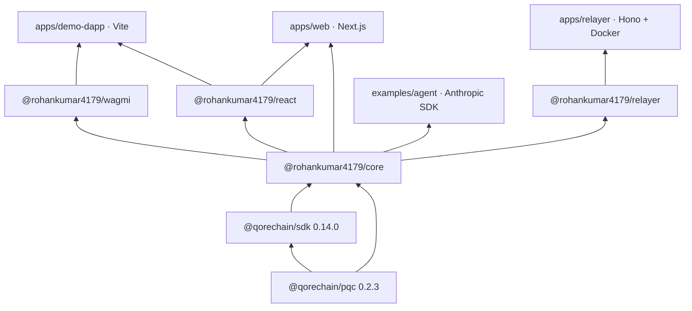

### Account model

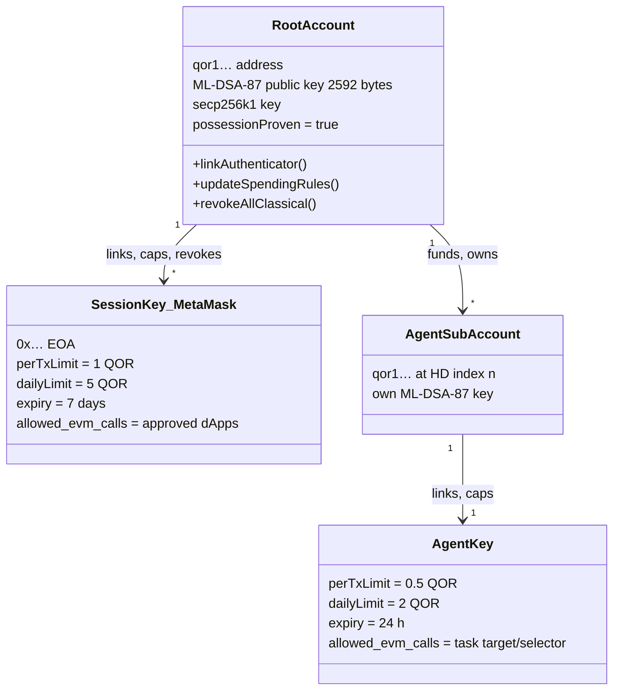

These are the default policies, and users can change them in the dashboard. The full model is in
[`architecture/02-account-model.md`](architecture/02-account-model.md).

### Deployment topology

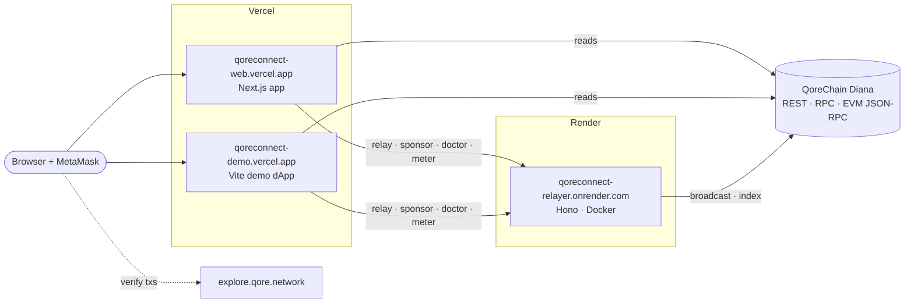

Deeper design notes are in [`architecture/`](architecture/): [system overview](architecture/01-system-overview.md),
[account model](architecture/02-account-model.md), [flows](architecture/03-flows.md),
[relayer](architecture/04-relayer.md), [SDK](architecture/05-sdk.md),
[threat model](architecture/06-security-threat-model.md), [tech stack](architecture/07-tech-stack-and-repo-layout.md) and
[verification plan](architecture/08-open-questions-and-verification.md).

---

## How it works: the flows

### Flow A: First-time onboarding (1 passkey tap, 1 MetaMask signature, 0 QOR)

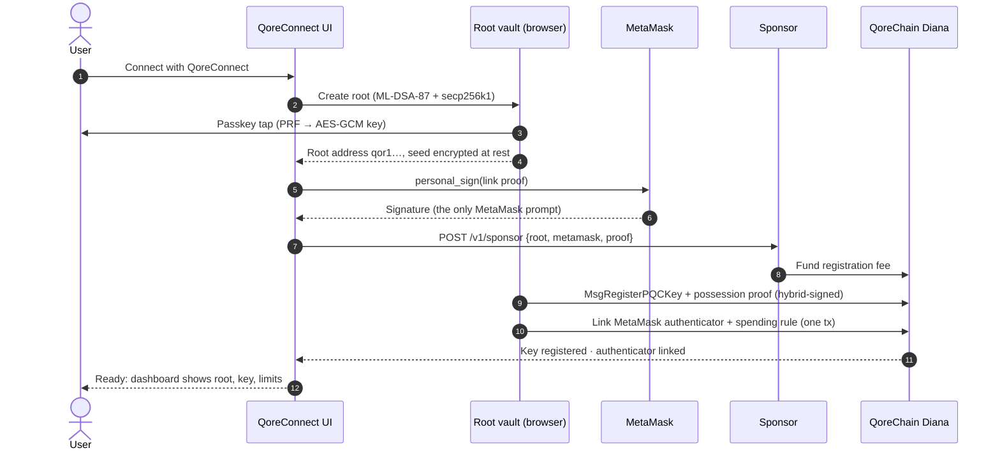

Measured: **19.8 s** from a fresh browser to a linked account on the live site (production Playwright E2E on Diana,
22 Nov 2026).

### Flow B: An everyday dApp transaction

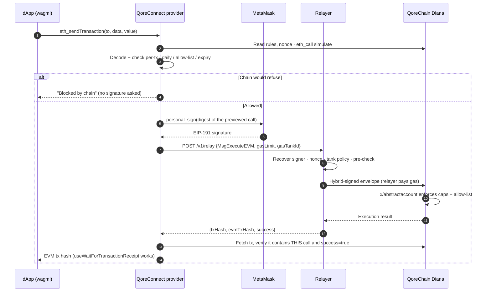

### Relayer pipeline

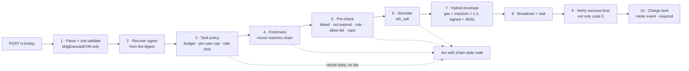

The pre-check is mandatory, not a nicety. On QoreChain a refused execution is still a code-0 transaction **whose fee is paid by
the relayer**, so refusing early saves real gas. See [`architecture/04-relayer.md`](architecture/04-relayer.md).

### Flow C: Approve a new dApp

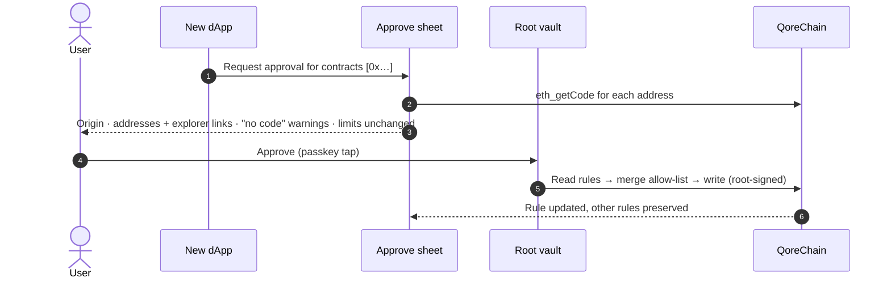

### Flow D: AI agent on root-signed instructions

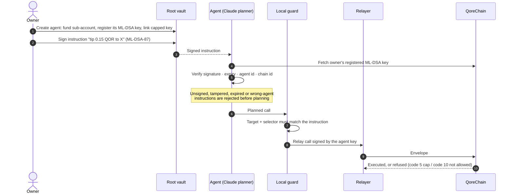

On Diana, a prompt-injected page ("send everything to 0x3600…") was obeyed by a deliberately compromised planner with the
local guard switched off and sent through the attacker's own relayer, and **the chain still refused it** (code 10,
[`AABFD632…DB6C`](https://explore.qore.network/tx/AABFD6321D45E1652B320FFB2222163C2824E711BCADE484C168F8171D36DB6C)).

### Flow E: Q-Day kill switch

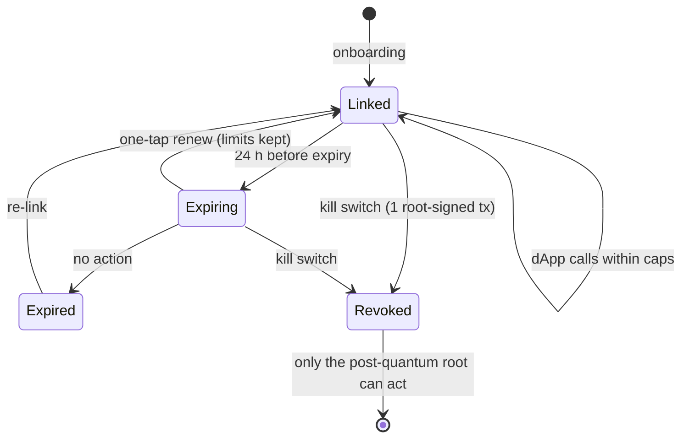

---

## Security model

### Defence in depth: three independent layers

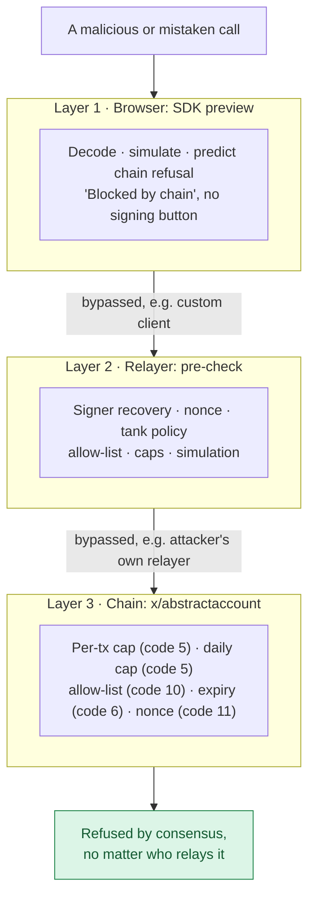

Layers 1 and 2 give good UX and save gas, but **layer 3 is the guarantee**. The attack demo proves it: a stolen session key
sent through an attacker-controlled relayer with no pre-check was refused by the chain
([`125E638C…EFF6`](https://explore.qore.network/tx/125E638C8670B49394EDF8F10BCE9DAC7C993A508D57833F9EAFC8B179B5EFF6)).

### Threats and mitigations (summary)

| # | Threat | Mitigation |
|---|---|---|
| T1 | Quantum attacker breaks the MetaMask key | It's only a session key: capped, scoped, expiring; the kill switch revokes every classical key in 1 tx |
| T2 | Quantum attacker breaks the root's secp256k1 half | Root transactions are hybrid; the ML-DSA-87 key is registered with a proof of possession |
| T3 / T4 | Phishing dApp or drainer contract | Readable preview + simulation; the approve sheet shows origin, addresses and code checks; the chain enforces the allow-list |
| T5 | Blind signing (MetaMask shows a raw digest) | The previewed call is frozen, and the digest is built from that same object |
| T6 / T7 / T9 | Relayer alters, replays or lies | Signer recovery, per-key nonce (chain code 11), and the SDK verifies the tx contains *this* call with `success=true` |
| T8 | Relayer censors | Any relayer URL works; the relayer is self-hostable (Docker); the root can always act directly |
| T10 | Prompt injection commands the agent | ML-DSA-87 owner-signed instructions, a local target/selector guard, and an isolated sub-account with its own caps |
| T11 / T12 | Rule overwrite or "no rule = no limit" | Read-merge-write, invariant checks after every write, a never-empty allow-list sentinel |
| T14 | Sponsor farming | One sponsorship per MetaMask address and per account, possession proof, per-IP and global limits |
| T15 / T16 | Device theft or loss | AES-GCM seed with addresses as AAD, fresh passkey assertion with user verification, recovery code |
| T17 | XSS reads the seed | Strict CSP with per-request nonce, no third-party scripts, `frame-ancestors 'none'`, plaintext zeroed after use |
| T18 / T19 | Supply chain or secrets leak | Exact pins, frozen lockfile, official `@qorechain/*` crypto only, gitleaks and a bundle secret scan in CI |

Every row maps to code lines and tests in [`docs/security.md`](docs/security.md), which also covers the five invariants
(I1–I5, passing live on Diana), the relayer hardening, the code review and the dependency audit.

### Chain error codes surfaced in the UI

| Code | Meaning | What the user sees |
|---|---|---|
| 5 | Spending limit exceeded | "Blocked by chain: over your limit" |
| 6 | Session expired | "This key expired. Renew it?" |
| 9 | Module disabled (mainnet) | "QoreConnect runs on Diana testnet only for now" |
| 10 | Not in the allow-list | "Blocked by chain: this dApp is not approved" |
| 11 | Replay / wrong nonce | Retried automatically once with a fresh nonce |

---

## Measured results

| Metric | Without QoreConnect | With QoreConnect | Source |
|---|---|---|---|
| MetaMask user's first QoreChain EVM tx | **Not possible** | 1 passkey tap + **1** MetaMask signature | [`prompts/STATUS.md`](prompts/STATUS.md) P09 |
| Fresh browser → linked account | Not possible | **19.8 s** (live site, production E2E) | [`prompts/STATUS.md`](prompts/STATUS.md) P15 |
| QOR the user needs to start | Must buy QOR | **0** | [`docs/testnet-evidence.md`](docs/testnet-evidence.md) |
| Loss if the MetaMask key breaks | Everything it controls | At most the daily limit, approved contracts only, until revoked | [`docs/security.md`](docs/security.md) T1 |
| dApp integration | Write your own PQC onboarding + relayer | **9 lines** of wagmi config | [`apps/demo-dapp/src/wagmi.ts`](apps/demo-dapp/src/wagmi.ts) |

### Measured on-chain costs (Diana, 0.15 uqor/gas)

| Action | Paid by | Gas | Fee |
|---|---|---|---|
| Register the ML-DSA-87 key (once) | Sponsor | 299,281 | 0.059 QOR |
| Link MetaMask with limits (once) | Sponsor | 226,107 | 0.045 QOR |
| dApp call through the relayer | dApp gas tank | 332,968 | 0.066 QOR |
| Call that moves value | dApp gas tank | 409,213 | 0.081 QOR |
| Kill switch (any number of keys, 1 tx) | User's root | 241,770 | 0.048 QOR |

Onboarding a new user costs the sponsor **about 0.10 QOR**, and the user pays nothing. Details are in [`docs/benchmark.md`](docs/benchmark.md).

---

## Engineering and optimizations

QoreConnect was tuned against the real Diana testnet, not a local mock. Each optimization below came from a measured problem
and is recorded in [`prompts/STATUS.md`](prompts/STATUS.md).

| Area | Problem we measured | Optimization | Result |
|---|---|---|---|
| **Onboarding time** | 35.2 s from a fresh browser to a linked account (P09) | Hedged, idempotent requests against slow Diana REST nodes; auto-resume, so a retry continues the same root instead of creating a second one | **19.8 s** on the live site (production E2E, P15) |
| **Signatures** | Each extra wallet prompt loses users | The link, spending rule and allow-list go in **one** root-signed tx; MetaMask signs a single link proof | **1** MetaMask signature to onboard |
| **Wasted relayer gas** | On QoreChain a refused execution is still a code-0 tx, and **the relayer pays its fee** (0.0975 QOR measured) | A mandatory pre-check before broadcast (signer, nonce, tank, rule, allow-list, caps, `eth_call` simulation) | Bad calls are refused **for free**, before they reach the chain |
| **Gas under-provisioning** | The chain refuses (code 10) when the envelope provides less gas than the user signed | `gas = max(simulated × 1.3, signedGasLimit + 450,000)` | The envelope always covers what the user signed |
| **Revocation cost** | Revoking keys one by one costs one tx each | All classical keys revoked in **one** root tx | Kill switch: 241,770 gas, 0.048 QOR, any number of keys |
| **Rule safety** | QoreChain replaces rule sets wholesale, so a naive update wipes other rules | Read-merge-write on every update, plus an invariant check after every write | Invariants I1 and I2 hold on Diana |
| **Gas-tank races** | Concurrent relays could overspend a tank | In-flight fee reservation; nonce freshness checked before broadcast | Tank budget reserved per in-flight call; stale nonces never broadcast (I3) |
| **Result integrity** | "Code 0" doesn't mean the call succeeded | The SDK re-fetches the tx and checks it contains *this* call and `success=true` | Invariant I4 verified on Diana |
| **Approval history** | Relayed calls don't appear in `eth_getLogs` on Diana | The scanner rebuilds allowances from the chain's tx search (any relayer, survives restarts) | Live allowances found and revoked on Diana |
| **Page speed** | The public meter must load fast for sharing | Indexer runs every 15 min inside the relayer; snapshots served from storage | `/meter` loads in **0.58 s** warm, 1.59 s cold |
| **Code quality** | A self-review found 10 issues (owner pinning, `X-Forwarded-For` trust, fee on timeout…) | Each fixed with a regression test | 130+ unit tests, 35 Foundry tests, production E2E 5/5 |

---

## How it compares

| | Plain MetaMask | QoreX (official wallet) | Passkey smart wallets | MetaMask + ERC-7715 | **QoreConnect** |
|---|---|---|---|---|---|
| Post-quantum root | No | **Yes** | No (P-256) | No | **Yes** (ML-DSA-87 hybrid) |
| Works on QoreChain's EVM lane | **No** | Yes | Not deployed | Not deployed | **Yes** (Diana) |
| User keeps MetaMask | Yes | No | No | Yes | **Yes** |
| Capped, scoped session keys | No | Not documented | Via modules | Caveat contracts | **Enforced by the chain** |
| Revoke every classical key in 1 tx | n/a | n/a | Per owner | Per delegation | **Yes** |
| Agents with capped keys | No | No | Via modules | Yes | **Yes, plus root-signed instructions** |
| First-tx gas | Buy QOR | Buy QOR | Paymaster | Paymaster | **Sponsored + gas tanks** |

**Where each one wins:** QoreX is the right answer for someone happy to switch wallets. QoreConnect is for the user who won't
switch wallets, and the dApp that doesn't want to lose them. Sources and caveats are in [`docs/benchmark.md`](docs/benchmark.md).

---

## Quick start

### Try it in 60 seconds (no install)

1. Open **<https://qoreconnect-demo.vercel.app>** in a browser with MetaMask.
2. Click **Connect with QoreConnect**, tap your passkey, and sign **once** in MetaMask.
3. Send a tip: read the preview, sign, and follow the transaction on [explore.qore.network](https://explore.qore.network).
4. Open the [**attack page**](https://qoreconnect-demo.vercel.app/#/attack) to see a drainer refused.
5. Open your [**dashboard**](https://qoreconnect-web.vercel.app/account) to change limits, add an agent, or press the kill switch.

> [!NOTE]
> The relayer runs on Render's free plan. The first request after it has been idle can take about a minute; check
> <https://qoreconnect-relayer.onrender.com/health>.

### Run everything locally

Needs **Node 22+**, **pnpm 11** and, for the contracts, **Foundry**.

```bash
git clone https://github.com/rohan911438/QoreConnect.git && cd QoreConnect
pnpm install
cp .env.example .env          # fill in SPONSOR_MNEMONIC, RELAYER_MNEMONIC, ADMIN_TOKEN (testnet only!)
pnpm build:packages
pnpm --filter @qoreconnect/relayer-app seed   # create the demo gas tank
pnpm dev:relayer              # http://localhost:8787/health
pnpm dev:web                  # http://localhost:3000  (onboarding, dashboard, /meter, /doctor, /exposure)
pnpm dev:demo                 # http://localhost:5173  (Quantum Tip Jar + #/attack)
```

The sponsor and relayer accounts need a little testnet QOR on Diana. Use separate accounts, and never a mainnet phrase.

### Self-host the relayer (Docker)

```bash
docker build -f apps/relayer/Dockerfile -t qoreconnect-relayer .
docker run -p 8787:8787 --env-file .env qoreconnect-relayer
```

Then point the connector at it with `relayerUrl: 'https://your-relayer'`.

---

## Integrate a dApp

```bash
npm install @rohankumar4179/wagmi @rohankumar4179/react wagmi@2 viem @tanstack/react-query
```

```ts
// wagmi.ts
import { createConfig } from 'wagmi'
import { qoreConnect, qoreTransport, qorechainDiana } from '@rohankumar4179/wagmi'
import { createQoreConnectUI } from '@rohankumar4179/react'

export const ui = createQoreConnectUI()
export const config = createConfig({
  chains: [qorechainDiana],
  connectors: [
    qoreConnect({
      appName: 'My dApp',
      contracts: ['0xYourContract'],          // becomes the session key's allow-list
      gasTankId: 'my-dapp',                   // your dApp pays gas, not the user
      relayerUrl: 'https://qoreconnect-relayer.onrender.com',
      ui: ui.hooks,
    }),
  ],
  transports: { [qorechainDiana.id]: qoreTransport() },
})
```

```tsx
// App root
import { QoreConnectProvider } from '@rohankumar4179/react'

<WagmiProvider config={config}>
  <QueryClientProvider client={queryClient}>
    <QoreConnectProvider ui={ui}>
      <App />
    </QoreConnectProvider>
  </QueryClientProvider>
</WagmiProvider>
```

Your existing `useWriteContract` and `useWaitForTransactionReceipt` code works unchanged. You'll find recipes, the stack
diagram and the comparison on the [**Developers page**](https://qoreconnect-web.vercel.app/developers).

---

## npm packages

| Package | Install | Use it for |
|---|---|---|
| [`@rohankumar4179/wagmi`](https://www.npmjs.com/package/@rohankumar4179/wagmi) | `npm i @rohankumar4179/wagmi` | A wagmi v2 connector that adds QoreConnect to an existing dApp |
| [`@rohankumar4179/react`](https://www.npmjs.com/package/@rohankumar4179/react) | `npm i @rohankumar4179/react` | Onboarding, signing preview, approval and unlock screens |
| [`@rohankumar4179/core`](https://www.npmjs.com/package/@rohankumar4179/core) | `npm i @rohankumar4179/core` | Root vault, session keys, EIP-1193 provider and agents (for wallets, dashboards and non-wagmi apps) |
| [`@rohankumar4179/relayer`](https://www.npmjs.com/package/@rohankumar4179/relayer) | `npm i @rohankumar4179/relayer` | Run your own relayer, sponsor and gas tanks (Node 22.5+) |

---

## Relayer API

Base URL (hosted): `https://qoreconnect-relayer.onrender.com`

| Method | Path | Purpose |
|---|---|---|
| `POST` | `/v1/relay` | Submit a MetaMask-signed `MsgExecuteEVM` → `{ txHash, evmTxHash, success, code }` |
| `GET` | `/v1/relay/:txHash` | Status of a submitted relay |
| `POST` | `/v1/sponsor` | Fund a new root's registration `{ rootAddress, metamaskAddress, proof }` |
| `GET` | `/v1/tanks/:id` | Gas-tank balance, daily spend and per-user cap |
| `POST` | `/v1/tanks` | Create a gas tank (admin token) |
| `GET` | `/v1/doctor/:address` | Ordered health checks with fixes (`?target=0x…`) |
| `GET` | `/v1/meter` · `/v1/meter/series` | Migration Meter snapshot and time series |
| `GET` | [`/health`](https://qoreconnect-relayer.onrender.com/health) | Relayer and sponsor balances, chain height, version |

The full specification is in [`architecture/04-relayer.md`](architecture/04-relayer.md).

---

## Repository layout

```text
QoreConnect/
├── packages/
│   ├── core/          root vault · chain client · session keys & rules · EIP-1193 provider · preview · agents
│   ├── wagmi/         wagmi connector · qoreTransport() · qorechainDiana
│   ├── react/         onboarding modal · approve sheet · signing preview · unlock prompt
│   └── relayer/       relay pipeline · sponsor · gas tanks · Migration Meter · Doctor
├── apps/
│   ├── web/           Next.js: landing · onboarding · /account · /meter · /doctor · /exposure · /developers
│   ├── demo-dapp/     Vite + wagmi: Quantum Tip Jar · #/attack
│   └── relayer/       Hono server · Dockerfile
├── examples/agent/    AI agent on root-signed instructions (Claude + deterministic fallback)
├── contracts/         QoreTipJar · Drainer · QoreConnectGuard · Foundry tests
├── architecture/      design docs 01–08
├── docs/              security · testnet evidence · benchmark · meter · exposure · video script
├── prompts/           P01–P16 build prompts and STATUS.md gate log
└── AI_USAGE.md        how AI was used to build QoreConnect
```

### Tech stack

| Layer | Technology |
|---|---|
| Post-quantum crypto | `@qorechain/sdk` 0.14.0, `@qorechain/pqc` 0.2.3 (ML-DSA-87, NIST category 5) |
| Frontend | Next.js (App Router, strict CSP), React, Vite, wagmi v2, viem, TanStack Query |
| Key storage | WebAuthn passkeys (PRF), AES-GCM, IndexedDB |
| Relayer | Node 22, Hono, zod, SQLite, Docker |
| Contracts | Solidity, Foundry (unit + fuzz) |
| AI | Anthropic SDK (Claude planner, strict tool schemas) |
| Testing | Vitest, Foundry, Playwright, live Diana integration tests |
| Hosting | Vercel (web, demo), Render (relayer) |

---

## Testing and quality

```bash
pnpm lint && pnpm typecheck && pnpm test     # unit tests (mocked chain), run in CI
pnpm test:contracts                          # Foundry: 35 unit + fuzz tests
pnpm test:integration                        # live on Diana (needs the operator keys)
pnpm demo:attack                             # a drainer dApp tries to empty an account and is refused
```

| Suite | What it covers |
|---|---|
| Unit (Vitest) | Vault, rules (read-merge-write), invariants, preview and digest binding, provider verification, relayer refusals, sponsor limits, agent instruction checks |
| Contracts (Foundry) | QoreTipJar 100% lines and branches, Drainer 100%, QoreConnectGuard 97.6% lines; mocked `pqcVerify` / `pqcKeyStatus` precompiles |
| Integration (Diana) | Onboarding, session keys, revoke, relay success and refusals, invariants I1–I5, agent run |
| E2E (Playwright) | Onboarding → dashboard → kill switch on the **production** site (5/5), security headers and CSP, 360 px layout |
| CI | Lint, typecheck, tests, relayer Docker build + `/health`, gitleaks, client-bundle secret scan |

---

## Testnet evidence and contracts

Explorer: <https://explore.qore.network>. All hashes and reproduction scripts are in
[`docs/testnet-evidence.md`](docs/testnet-evidence.md) and [`prompts/STATUS.md`](prompts/STATUS.md).

| What | Diana transaction |
|---|---|
| ML-DSA-87 key registration (sponsor-funded) | [`A4A820DD…F839`](https://explore.qore.network/tx/A4A820DDBCAA23E64B67A40E8755C2EBC69CC637CAA4EA61563DB736A5C3F839) |
| MetaMask authenticator linked with limits | [`08EAAB70…3C07`](https://explore.qore.network/tx/08EAAB70FF9AD7B5AE9875A8F58522A1A98EFF97CDF66794FED1474932ED3C07) |
| `MsgExecuteEVM` through the relayer | [`F0D97E75…E913`](https://explore.qore.network/tx/F0D97E75412C83976175F54C175E0677886EC716D800F6CC9AEDC3A8EF3BE913) |
| Daily cap refused by the chain (code 5) | [`4308ADCC…CEB8`](https://explore.qore.network/tx/4308ADCC09358FB59E53F9899938317D68E91ED1ADF5341F296732515638CEB8) |
| Drainer with a stolen key, attacker's relayer: refused (code 10) | [`125E638C…EFF6`](https://explore.qore.network/tx/125E638C8670B49394EDF8F10BCE9DAC7C993A508D57833F9EAFC8B179B5EFF6) |
| Kill switch: several keys revoked in one root tx | [`A5D32D10…98A2`](https://explore.qore.network/tx/A5D32D1017CDD11F3700EFBD44F86161FBE61E64D96B410E7838D598F82398A2) |
| Agent action on a root-signed instruction | [`B10FCF49…75D5`](https://explore.qore.network/tx/B10FCF490C23D5578EFE81CFDEB1519A88BFA68B7650345E81B53405C36275D5) |
| Prompt-injected agent call refused (code 10) | [`AABFD632…DB6C`](https://explore.qore.network/tx/AABFD6321D45E1652B320FFB2222163C2824E711BCADE484C168F8171D36DB6C) |
| Contract deploy inside a scoped EVM window | [`0x24f70a3e…d556`](https://explore.qore.network/tx/0x24f70a3e3bafce83258cdc8591881f1d10864fcd05b547cddeb125d7d272d556) |

| Contract | Address |
|---|---|
| QoreTipJar | `0x42653b89eff2a993cf2767fedef783366f53aea4` |
| Drainer (attack demo, never approved) | `0x36003c3cea4a8e38cff894cce2c1d1be94e23baa` |
| QoreConnectGuard (`pqcVerify` + `pqcKeyStatus`) | `0x1a5b03240e7b3ce11fb8e59ef5da1cb60fbe9eab` |

| Testnet account | Role |
|---|---|
| `qor1wpae9a38v7vlj2xvun2cw0669w4ls568zar4w8` | Operator and sponsor |
| `qor1zl9mfjhqksshzjpf7erp9nypadncfz3n42hct8` | Relayer (ML-DSA registered) |
| `qor1gg54y9regwhrd7yn29aw6qy7lqvk83h4v9e9ju` | Attack-demo root |
| `qor1kkuqqp0rqpla3qam239j4p8fzh525nv0e0ez5n` | Agent owner root |
| `qor1q9scherh67uk63enc8l0udkysqxv4gpv4szu7j` | AI agent sub-account |

---

## Honest limitations

- The MetaMask key is **classical**: capped, scoped and revocable, but not quantum-safe. The root key is the quantum-safe part,
  and the UI labels classical signatures as classical.
- MetaMask shows a raw digest when it signs. QoreConnect's preview is what you read, and the digest is bound to that exact preview.
- **Diana testnet only.** Abstract accounts are switched off on QoreChain mainnet (code 9).
- The relayer is a liveness dependency. It's self-hostable, any relayer URL works, and the root key can always act directly.
- Passkey PRF isn't available in every browser; the fallback is a password.
- Not audited.

---

## Status and roadmap

| Feature | Status |
|---|---|
| Root vault (passkey or password), recovery code | ✅ Shipped |
| Sponsored onboarding with one MetaMask signature | ✅ Shipped |
| Session keys, limits, allow-list, revoke, kill switch | ✅ Shipped |
| Relayer with pre-check and gas tanks | ✅ Shipped |
| wagmi connector, EIP-1193 provider, signing preview | ✅ Shipped |
| Tip Jar demo dApp and attack demo | ✅ Shipped |
| Agent mode (root-signed instructions, sub-accounts) | ✅ Shipped (the live Claude run needs an API key; the deterministic planner is verified on Diana) |
| Migration Meter, Doctor, exposure report | ✅ Shipped |
| Presets, renewal, approval scanner | ✅ Shipped |
| Hosted deployment (Vercel + Render) | ✅ Shipped |
| npm packages 0.1.0 | ✅ Shipped |
| Demo video | ✅ [Shipped](https://youtu.be/Uf4OgEPN-0w) |

**Next:** a security audit; more wallets (any EIP-1193 wallet as the session key); a "Move to QoreX" path for users ready to go
fully post-quantum; dApp-side gas-tank dashboards; and mainnet as soon as QoreChain enables abstract accounts there.

---

## All links

| Resource | Link |
|---|---|
| Live web app | <https://qoreconnect-web.vercel.app> |
| Dashboard | <https://qoreconnect-web.vercel.app/account> |
| Developers page | <https://qoreconnect-web.vercel.app/developers> |
| Migration Meter | <https://qoreconnect-web.vercel.app/meter> |
| Doctor | <https://qoreconnect-web.vercel.app/doctor> |
| Q-Day exposure report | <https://qoreconnect-web.vercel.app/exposure> |
| Demo dApp (Quantum Tip Jar) | <https://qoreconnect-demo.vercel.app> |
| Attack demo | <https://qoreconnect-demo.vercel.app/#/attack> |
| Relayer health | <https://qoreconnect-relayer.onrender.com/health> |
| Demo video | <https://youtu.be/Uf4OgEPN-0w> |
| Hackathon submission | <https://build.qorechain.io/p/qoreconnect> |
| GitHub repository | <https://github.com/rohan911438/QoreConnect> |
| npm: core · react · wagmi · relayer | [core](https://www.npmjs.com/package/@rohankumar4179/core) · [react](https://www.npmjs.com/package/@rohankumar4179/react) · [wagmi](https://www.npmjs.com/package/@rohankumar4179/wagmi) · [relayer](https://www.npmjs.com/package/@rohankumar4179/relayer) |
| Diana explorer | <https://explore.qore.network> |
| QoreChain | <https://qorechain.io> |
| QoreChain kits | [`@qorechain/sdk`](https://www.npmjs.com/package/@qorechain/sdk) · [`@qorechain/pqc`](https://www.npmjs.com/package/@qorechain/pqc) |
| Docs in this repo | [security](docs/security.md) · [testnet evidence](docs/testnet-evidence.md) · [benchmark](docs/benchmark.md) · [Migration Meter](docs/migration-meter.md) · [exposure](docs/exposure.md) · [video script](docs/video-script.md) · [AI usage](AI_USAGE.md) |

---

## Credits and licence

Built on QoreChain's official kits: [`@qorechain/sdk`](https://www.npmjs.com/package/@qorechain/sdk) 0.14.0 (accounts,
hybrid signing, abstract-account messages) and [`@qorechain/pqc`](https://www.npmjs.com/package/@qorechain/pqc) 0.2.3
(ML-DSA-87, used through the SDK's `pqcSign` / `pqcVerify`). Also wagmi, viem, Next.js, Hono, Foundry and the Anthropic SDK.

Licensed under [Apache-2.0](LICENSE).

<div align="center">

**Build before Q-Day.** [#BuildBeforeQDay](https://x.com/hashtag/BuildBeforeQDay)

</div>
