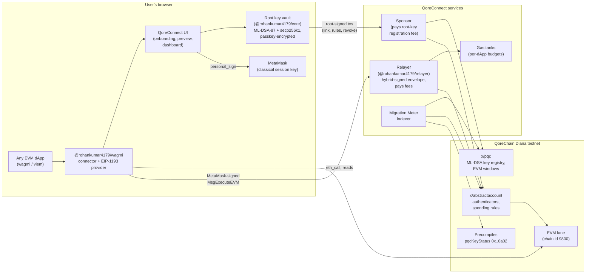

# 01 — System overview

## Components

## What each component does

| Component | Package / app | Responsibility |
|---|---|---|
| **Root key vault** | `packages/core` | Generates the seed, derives the QoreChain account and ML-DSA-87 key with the official SDK, encrypts the seed with a passkey-derived key, exports the recovery code, signs root-key transactions |
| **Chain client** | `packages/core` | Builds and broadcasts: ML-DSA key registration, authenticator link with possession proof, spending rule updates, EVM window open/close, revoke. Reads auth nonces, rules, authenticators, key status |
| **EIP-1193 provider** | `packages/core` | Intercepts `eth_sendTransaction` (and `wallet_sendCalls` if used), turns it into a MetaMask-signed `MsgExecuteEVM`, sends it to the relayer, waits for the result. Passes reads (`eth_call`, `eth_getBalance`, and so on) to the public EVM RPC |
| **wagmi connector** | `packages/wagmi` | Wraps the provider as a wagmi connector; announces via EIP-6963 so wallet pickers list it |
| **React UI kit** | `packages/react` | Onboarding modal, signing preview, approve-dApp sheet, honesty labels |
| **Relayer** | `packages/relayer` + `apps/relayer` | Validates the request against gas-tank policy, wraps the MetaMask-signed message in a hybrid-signed transaction from the relayer account, broadcasts, checks `success` in the execution event (not only code 0), returns the EVM transaction hash |
| **Sponsor** | inside `apps/relayer` | Pays fees for a new account's first transactions (ML-DSA key registration, first link). The user's browser signs them; the sponsor only funds the fee *(mechanism verified in P01)* |
| **Gas tanks** | inside `apps/relayer` | Per-dApp budget, per-user daily cap, rate limits, kill switch per tank |
| **Web app** | `apps/web` | Hosted onboarding, dashboard (approved dApps, limits, revoke, Q-Day kill switch, agent keys), Doctor, Migration Meter |
| **Demo dApp** | `apps/demo-dapp` | A small wagmi app integrating `@rohankumar4179/wagmi`, used in the video |
| **Contracts** | `contracts/` | Demo target contract, a malicious "drainer" for the attack demo, Foundry tests |
| **Agent example** | `examples/agent` | AI agent holding a capped key; verifies root-signed instructions; acts through the relayer |

## Trust boundaries

| Boundary | What crosses it | Who is trusted for what |
|---|---|---|
| Browser ↔ MetaMask | `personal_sign` requests | MetaMask holds the classical key. We trust it to sign only what the user approves. |
| Browser ↔ relayer | MetaMask-signed `MsgExecuteEVM` | The relayer **cannot change** the signed content (the chain checks the signature over the digest, including gas limit with digest v2). The relayer is trusted only for liveness and fee payment. |
| Browser ↔ sponsor | Root-signed transactions needing a fee | The sponsor sees the transactions and pays fees. It cannot sign for the user. *(Exact fee-payer mechanism verified in P01.)* |
| Relayer ↔ chain | Hybrid-signed envelope | The chain enforces the user's spending rules, allow-list, expiry and nonce. **The relayer cannot exceed them.** |
| Root key ↔ everything | Root key never leaves the browser | Only the user (passkey) can unlock it. |

The core guarantee: **even a fully compromised relayer cannot spend beyond the user's on-chain rules.** It can only refuse service.

## Data stored

| Data | Where | Protection |
|---|---|---|
| Encrypted seed | Browser (IndexedDB) | AES-256-GCM with a key derived from the passkey PRF output (fallback: password + scrypt) |
| Recovery code | Shown once; user saves it | User responsibility; prompted when balance passes a threshold |
| Approved dApps list | On-chain (spending rule `allowed_evm_calls`) plus a local label cache | On-chain is the source of truth |
| Gas tank balances, rate-limit counters | Relayer database (SQLite or Postgres) | Server-side; not security-critical for users |
| Migration Meter aggregates | Relayer database / indexer cache | Public data, recomputable from chain |

No user private key is ever sent to any server.
