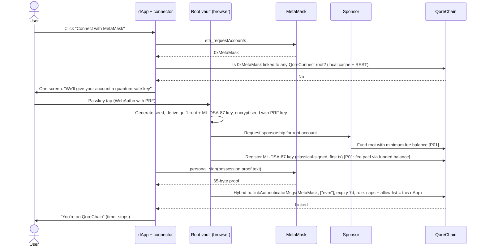
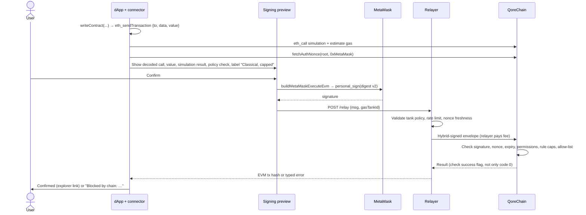
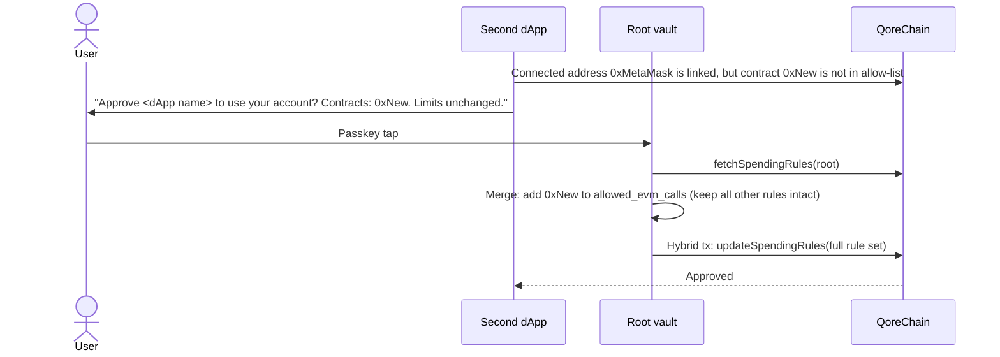
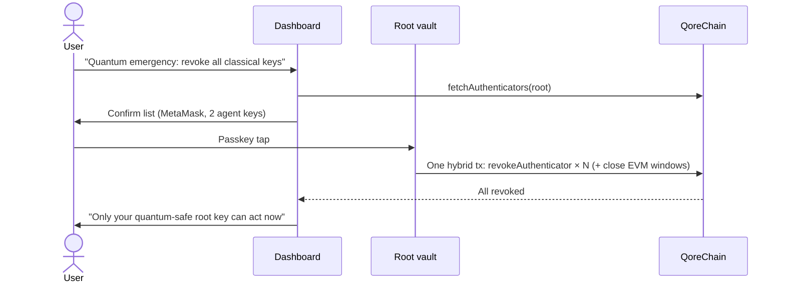

# 03 — Flows

Each flow lists who signs what, and which assumptions are verified in prompt P01 (marked **[P01]**).

---

## Flow A: First-time onboarding (target: under 60 seconds)



**Sponsorship design.** The simplest reliable approach is that the sponsor sends a small amount of QOR to the new root account (enough for registration and linking fees), and the root account pays its own fees. Fee grants (`feegrant` module) would be cleaner if available. **[P01]** confirms which works.

**Abuse protection.** One sponsorship per MetaMask address and per browser, rate-limited per IP, with a global daily budget. A sponsored balance is small (fees only), so abuse costs little.

---

## Flow B: Everyday transaction



**Assumptions [P01]:**
1. `buildMetaMaskExecuteEvm` (or an underlying builder) accepts **calldata** (`data`), not only `to` and `value`.
2. Whether an open EVM window on the root account is required for authenticator `MsgExecuteEVM`.
3. The returned result exposes the inner EVM transaction hash.

**If a window is required (assumption 2 is true):** the root opens a **scoped window** at link time (bounds: at most 17,280 blocks, which is about 11 hours at the measured 2.33 s block time, so renewal is needed at least twice a day; transaction count; total uqor ≤ daily cap plus fees; `allowed_targets` = allow-list if supported). The dashboard renews it with a passkey tap. This also satisfies category requirement R1.

---

## Flow C: Approve a new dApp



**Where does the dApp's contract list come from?** The connector is configured by the dApp with `contracts: [...]`, and the approval sheet shows them. A malicious dApp could list a drainer contract, so the sheet shows the addresses clearly, and caps still apply.

---

## Flow D: Revoke one key / Q-Day kill switch



---

## Flow E: AI agent key (agent mode)

```mermaid
sequenceDiagram
  actor O as Owner
  participant W as Dashboard
  participant V as Root vault
  participant A as AI agent
  participant R as Relayer
  participant C as QoreChain

  O->>W: "New agent: pay invoices on 0xPayGate, max 2 QOR/day, 24h"
  W->>A: Request agent public address
  A-->>W: 0xAgent
  O->>V: Passkey tap
  V->>C: Hybrid tx: link 0xAgent ["evm"], expiry 24h, rule: 0.5/tx, 2/day, allowed_evm_calls 0xPayGate/0xSELECTOR
  O->>V: Sign instruction with root key (QoreSign message signing): {task, limits, nonce, expiry}
  V-->>A: Signed instruction
  A->>A: Verify instruction signature against root's registered key; reject unsigned / tampered
  A->>A: Plan action (Claude, tool use)
  A->>R: EIP-191-signed MsgExecuteEVM
  R->>C: Envelope
  C-->>A: Executed, or refused (code 5 / 10) if outside limits
```

**Authenticated messaging, two layers:**
1. **Owner → agent:** the agent acts only on instructions signed by the root key. Text found on a web page or in a tool result cannot become an instruction.
2. **Agent → chain:** every action is EIP-191-signed by the agent key with a per-key nonce; the chain enforces caps and allow-list regardless of what the model decides.

---

## Flow F: Recovery and "Move to QoreX"

1. **Recovery code export:** after a balance threshold or on request, the vault decrypts the seed (passkey tap) and shows it once as a recovery code, with a confirmation quiz.
2. **New device:** enter the recovery code; the vault re-derives the root key and re-encrypts it with the new device's passkey.
3. **Move to QoreX** *(only if [P01] confirms QoreX imports the seed)*: guided steps to import the seed into QoreX, then optional local wipe.

---

## Flow G: Doctor

Input: any `0x` or `qor1` address. Output: the first failing condition and a one-click fix.

| Check | Source | Fix |
|---|---|---|
| ML-DSA key registered and `possessionProven` | `pqcKeyStatus` precompile (`0x...0a02`) or REST | Onboard (Flow A) |
| EVM window open, with remaining tx count and budget | REST | Open or renew window |
| Authenticator linked, not expired | `fetchAuthenticators` | Link or renew |
| Enabled rule bounding every denom | `fetchSpendingRules` | Set default rule |
| Target contract in allow-list | Rule + provided target | Approve dApp (Flow C) |
| Relayer tank has budget | Relayer API | Contact dApp |

---

## Flow H: Migration Meter indexing

A small indexer (inside `apps/relayer` or a cron in `apps/web`) periodically:
1. Counts QoreConnect-onboarded accounts (from the relayer database and on-chain links).
2. Counts relayed `MsgExecuteEVM` executions and their value.
3. Samples recent EVM-lane activity on Diana and classifies the sender: has a registered ML-DSA key (post-quantum rooted) vs. not. **[P12 defines the exact query; testnet history is pruned, so we keep our own time series from the day we start.]**
4. Stores a time series; the public page renders it with links to the REST endpoints and explorer for every number.
