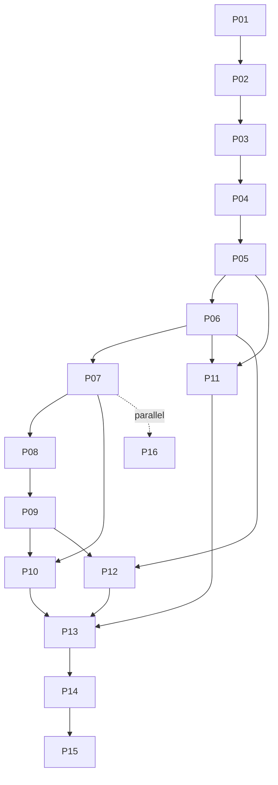

# Build prompts — how the build runs

The build is a chain of **16 prompts**, executed **in order**. Each prompt is a self-contained instruction for Claude Code (or a developer). A prompt is only "done" when its **validation gate** passes. The next prompt never starts on a failed gate.

---

## Execution rules

1. **One prompt at a time.** Paste the prompt file's "Prompt" section into Claude Code (or say "run prompts/P0X").
2. **Read the context first.** Every prompt lists the files it depends on. They are part of the instruction.
3. **Run the validation gate.** Every item must pass. Commands must exit 0; manual checks must be ticked by a human.
4. **Record the result** in [`STATUS.md`](STATUS.md): date, pass/fail, evidence (transaction hashes, test counts, screenshots), deviations.
5. **On failure, follow the prompt's failure branch.** Do not improvise a different design without updating `architecture/` first.
6. **Never skip P01.** It decides whether the design is viable.
7. **Commit after every passed gate**, with the message `P0X: <title> (gate passed)`.
8. **Facts beat docs.** If the testnet behaves differently from the docs, the testnet wins: update `architecture/08-open-questions-and-verification.md` and the affected architecture file.
9. **Secrets never go in the repo or in a prompt.** Use `.env` (git-ignored).

## Prompt format

Every prompt file has the same sections:

| Section | Purpose |
|---|---|
| **Goal** | What exists when the prompt is done |
| **Depends on** | Prompts that must have passed |
| **Read first** | Files to load as context |
| **Prompt** | The instruction to execute |
| **Deliverables** | Files and artefacts that must exist |
| **Validation gate** | Commands and checks; all must pass |
| **Failure branch** | What to do if the gate fails |
| **Time box** | Planned effort; if exceeded by 50%, stop and re-plan |

## Sequence and schedule

| # | Prompt | Date (2026) | Time box | Gate type |
|---|---|---|---|---|
| P01 | [Feasibility spike on Diana testnet](P01-feasibility-spike.md) | 22 Nov | 1 day | **Go / no-go** |
| P02 | [Monorepo scaffold and CI](P02-monorepo-scaffold.md) | 23 Nov (am) | 3 h | Build + CI |
| P03 | [Root key vault](P03-root-key-vault.md) | 23 Nov | 5 h | Unit tests |
| P04 | [Chain client and sponsored onboarding](P04-chain-client-and-onboarding.md) | 24 Nov | 1 day | Testnet integration |
| P05 | [Session-key linking, rules and dApp approval](P05-session-keys-and-rules.md) | 25 Nov (am) | 5 h | Testnet integration |
| P06 | [Relayer service](P06-relayer.md) | 25 Nov | 6 h | Testnet integration |
| P07 | [EIP-1193 provider and wagmi connector](P07-provider-and-wagmi.md) | 26 Nov | 1 day | End-to-end |
| P08 | [Signing preview and honesty labels](P08-signing-preview.md) | 27 Nov (am) | 4 h | UI + unit |
| P09 | [Web app: onboarding and dashboard](P09-web-app-dashboard.md) | 27 Nov | 1 day | End-to-end + manual |
| P10 | [Contracts, demo dApp and attack demo](P10-contracts-and-demo-dapp.md) | 28 Nov | 1 day | forge test + E2E |
| P11 | [Agent mode](P11-agent-mode.md) | 29 Nov (am) | 5 h | Testnet integration |
| P12 | [Migration Meter and Doctor](P12-migration-meter-and-doctor.md) | 29 Nov | 5 h | Data + manual |
| P13 | [Hardening and security review](P13-hardening.md) | 30 Nov | 1 day | Tests + review |
| P14 | [Deploy and publish](P14-deploy-and-publish.md) | 1 Dec (am) | 4 h | Live checks |
| P15 | [Submission package](P15-submission-package.md) | 1–2 Dec | 1 day | Checklist |
| P16 | [Ecosystem outreach kit](P16-ecosystem-outreach.md) | 26 Nov onward (parallel) | ongoing | Integrations count |

**Feature freeze: 30 Nov, 23:59 UTC.** After that, only fixes, docs and the video.

P16 runs in parallel from 26 Nov, as soon as P07 publishes a usable SDK.

## Dependency graph

## Buffer and cut rules

- Each day has about 20% slack. If a prompt overruns its time box by 50%, stop, record why in `STATUS.md`, and apply the cut order from [`idea/05-scope-and-non-goals.md`](../idea/05-scope-and-non-goals.md).
- If P01 returns **no-go**, stop the chain and re-plan with the user before writing any product code.
